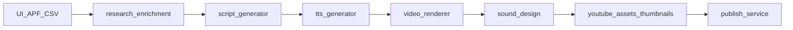

# ShadowCast Architecture

## Intent

ShadowCast converts structured affiliate product data into short-form (9:16) and long-form (16:9) kinetic text videos, YouTube posting packages, thumbnails, and multi-platform publish payloads.

## Runtime components

| Layer | Location | Role |
|-------|----------|------|
| API / jobs | `backend/app.py`, `job_store.py` | FastAPI, job lifecycle, artifact cache, batch workers |
| Scripts | `script_generator.py`, `prompts.py`, `script_postprocessor.py`, `content_styles.py` | LLM JSON scripts + layout injection |
| Research / RAG | `research_enrichment.py`, `rag_store.py`, `style_rules_retrieval.py` | Amazon/YouTube research + style-rules corpus |
| TTS | `tts_generator.py` | Per-segment VO; audio-driven durations + timing sidecar |
| Render | `video_renderer.py`, `kinetic_effects.py`, `comparison_layouts.py`, `bg_generator.py`, `brand_overlays.py` | MoviePy frames, captions, lower-thirds |
| Product media | `product_media.py` | Optional product still download/cache + compositing |
| Audio | `sound_design.py`, `audio_options.py` | Music beds or synth, ducking, two-pass loudnorm |
| Assets | `youtube_assets_generator.py`, `thumbnail_generator.py`, `visual_quality.py` | SEO packages, thumbs, contrast audit |
| Publish | `publish_service.py`, `posting_package_adapter.py`, `publishers/*`, `oauth_manager.py` | YouTube / Meta / TikTok / Rumble |
| UI | `frontend/index.html` | SPA |
| Quality | `video_claims.py`, `video_claim_audit.py`, `backend/eval/*`, `scripts/quality/` | Contracts, eval, CI gates |

## Key dependencies

- `fastapi`, `uvicorn` — API
- `moviepy`, `Pillow`, `numpy`, `scipy` — media
- `ffmpeg` / `ffprobe` — mux, loudnorm, social repurpose
- Optional: `openai`, Kokoro/Piper TTS, Playwright (Rumble)

## Data flow

1. Input payload (UI, batch CSV, or APF import).
2. Optional research enrichment + style-rules RAG into script prompts.
3. Scripts generated per hook × format; postprocessor injects required layouts.
4. If TTS on: measure speech, rewrite segment durations, write timing sidecar.
5. MoviePy render (product still on hero segments when `image_url` present) + Shorts captions / lower-thirds.
6. Music bed or synth → duck under VO → two-pass loudnorm ≈ −14 LUFS.
7. YouTube package + thumbnails; publish adapters per platform.

## Env flags (selected)

| Variable | Effect |
|----------|--------|
| `HOST` / `PORT` | Bind address (default `127.0.0.1:8000`) |
| `STYLE_RULES_RAG` | `0` disables style corpus injection |
| `SHADOWCAST_BATCH_WORKERS` | Parallel batch product workers |
| `CORS_ORIGINS` / `CORS_ALLOW_ALL` | CORS |
| `INTERNAL_SERVICE_SECRET` | Mission Control / APF machine auth |
| `ALLOW_GTTS_PUBLISH` | `1` allows live publish with gTTS-only voice |
| `SHADOWCAST_TTS_DEFAULT` | `0` forces API default TTS off |

## Integration points

- APF direct-import payloads for product metadata (`image_url` optional)
- Mission Control orchestration via service secret
- Shared `INTERNAL_SERVICE_SECRET` for M2M requests

## Non-goals (current architecture)

- Remotion / diffusion gen-video / WhisperX (research watch-list only)
- Independent stage workers / Redis-Celery (see `future-improvements/`)
