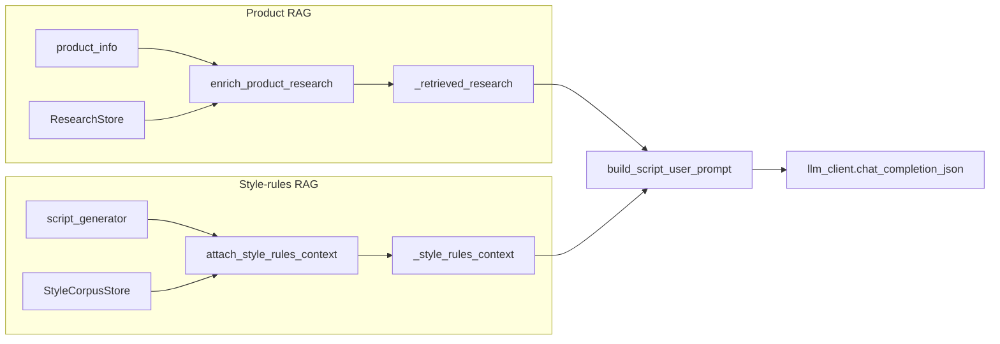

# RAG Design (ShadowCast)

ShadowCast runs two retrieval layers:

| Layer | Module | Injected into |
|-------|--------|---------------|
| **Product research RAG** | [`research_enrichment.py`](../backend/research_enrichment.py) → [`ResearchStore`](../backend/rag_store.py) | Script + YouTube user prompts via `_retrieved_research` |
| **Style-rules RAG** | [`style_rules_retrieval.py`](../backend/style_rules_retrieval.py) → [`StyleCorpusStore`](../backend/rag_store.py) | Script user prompt only via `_style_rules_context` (default ON; `STYLE_RULES_RAG=0` to disable) |

## Style-rules corpus

Nine markdown docs under [`backend/eval/rag_corpus/`](../backend/eval/rag_corpus/):

| Doc | Role | Sync policy |
|-----|------|-------------|
| `BUYER_LANGUAGE_RULES.md` | Banned affiliate-speak, buyer-facing tone | RAG-only (canonical here) |
| `AUDIT.md` | Prompt eval gates (corpus copy) | Mirror of themes in `backend/eval/AUDIT.md` |
| `MOCK_SCRIPT_EXAMPLES.md` | Format exemplars | RAG-only |
| `RENDERER_CONTRACT.md` | LLM ↔ MoviePy duration/layout contract | RAG-only (canonical here) |
| `STYLE_RENDERING_CHECKLIST.md` | Layout / segment rules (short retrieval stub) | Intentional trim; full operator checklist stays in `docs/STYLE_RENDERING_CHECKLIST.md` |
| `ARCHITECTURE.md` | System structure | Mirror of `docs/ARCHITECTURE.md` |
| `RUNBOOK.md` | Ops | Mirror of `docs/RUNBOOK.md` |
| `RECOVERY.md` | Recovery | Mirror of `docs/RECOVERY.md` |
| `SOCIAL_READINESS.md` | Posting readiness | Mirror of `docs/SOCIAL_READINESS.md` |

Canonical product docs live under [`docs/`](.). When editing ops/architecture/recovery/social readiness, update `docs/` first, then copy those four mirrors into `rag_corpus/`. Do **not** overwrite the shortened style checklist stub with the full `docs/` checklist.

`GET /api/media-library` is operator inventory (music/B-roll findability), **not** a RAG store. Amazon review themes and YouTube research angles enter scripts via [`research_enrichment.py`](../backend/research_enrichment.py) / [`youtube_research.py`](../backend/youtube_research.py), separate from style-rules retrieval.

Canonical prompt audit lives in [`backend/eval/AUDIT.md`](../backend/eval/AUDIT.md).

## Runtime stack (current)

Implemented in [`rag_store.py`](../backend/rag_store.py) — **not** pgvector or cross-encoder in production today:

- **Chunking:** sentence-based (`chunk_text_sentences`), max ~1200 chars, 1-sentence overlap
- **Embeddings:** Ollama-compatible API (`nomic-embed-text` default) via `embed_base_url` from [`llm_config.get_config()`](../backend/llm_config.py)
- **Retrieval:** hybrid dense (embedding cosine) + lexical overlap + BM25
- **Rerank:** query-intent rerank (`default_rerank`) on doc-level hits

Product and style stores share chunking/hybrid primitives; style retrieval is doc-level aggregation over sentence chunks.

## Eval baselines

| Gate | Script | Baseline |
|------|--------|----------|
| Corpus precision@5 | `eval/run_corpus_rag_eval.py` | CI gate **≥ 0.80** (re-run locally after corpus edits; do not cite product groundedness file for this metric) |
| Product groundedness | `eval/run_rag_eval.py` | **0.979** (`eval/baselines/rag_product_baseline.json`) |

CI runs both gates in [`.github/workflows/quality-gates.yml`](../.github/workflows/quality-gates.yml).

Legacy offline tool: `scripts/quality/retrieval_evaluator.py` (TF-IDF fixtures; superseded for gates by `run_corpus_rag_eval.py`).

## Integration



Injection is **user prompt only** ([`build_script_user_prompt`](../backend/prompts.py)), not [`SCRIPT_SYSTEM_PROMPT`](../backend/prompts.py), to keep the system prefix stable for cache-friendly layout.

YouTube assets and publish paths do **not** use style-rules RAG in the current pass.

## Commands

```bash
cd backend
python3 eval/run_corpus_rag_eval.py --min-precision 0.80
python3 eval/run_rag_eval.py --min-relevance 0.80
python3 eval/structural_gate.py
```

Design / offline tooling (optional):

```bash
python3 scripts/quality/chunking_optimizer.py backend/eval/rag_corpus --extensions .md -o backend/eval/artifacts/chunking.json
python3 scripts/quality/rag_pipeline_designer.py backend/eval/fixtures/rag_requirements.json -o backend/eval/artifacts/rag_design.json
python3 scripts/quality/retrieval_evaluator.py backend/eval/fixtures/rag_queries.json backend/eval/rag_corpus backend/eval/fixtures/rag_ground_truth.json -o backend/eval/artifacts/rag_eval.json
```

## Future scale (not implemented)

- pgvector or dedicated vector service for cross-job persistence
- Cross-encoder reranking if precision drops on an expanded corpus
- Sentence-transformers sidecar if Ollama embeddings are unavailable
- Expand corpus with live `prompts.py` exports and production script exemplars

Do not block current shipping on these; eval gates pass on the in-memory hybrid stack above.
