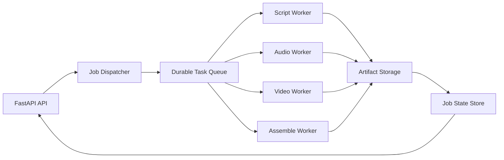

# Target Architecture (Future Rewrite)

## Scope

This future work is an orchestration rewrite only. Existing generation logic, renderer logic, and API surfaces are reused whenever possible.

## Proposed Topology

## Stage Contracts

### 1) Script Stage

**Input**
- Product metadata
- Selected hook types
- Selected formats

**Output**
- `{slug}_{hook}_scripts.json`
- Validation metadata (missing fields, fallback flags)

### 2) Audio Stage

**Input**
- Script payload
- Audio mood + TTS settings

**Output**
- `{slug}_{hook}_{format}_voiceover.mp3`
- Optional music/SFX mix artifacts

### 3) Video Stage

**Input**
- Script payload
- Visual/template config

**Output**
- `{slug}_{hook}_{format}_video_only.mp4`

### 4) Assemble Stage

**Input**
- Video-only artifact
- Audio artifact set
- Product/link metadata

**Output**
- Final `{slug}_{hook}_{format}.mp4`
- YouTube package JSON
- Thumbnail/text assets

## Operating Principles

- Idempotent stage execution (same input, same artifact target).
- Retry safety using artifact existence checks and stage checkpoints.
- Stage-level status/error telemetry for faster recovery.
- API compatibility preserved for existing frontend and automation clients.
- Clear provenance markers on generated artifacts.

## Non-Goals (For This Rewrite)

- No frontend redesign.
- No content strategy rewrite.
- No hard dependency on Redis/Celery unless trigger criteria prove it is required.
